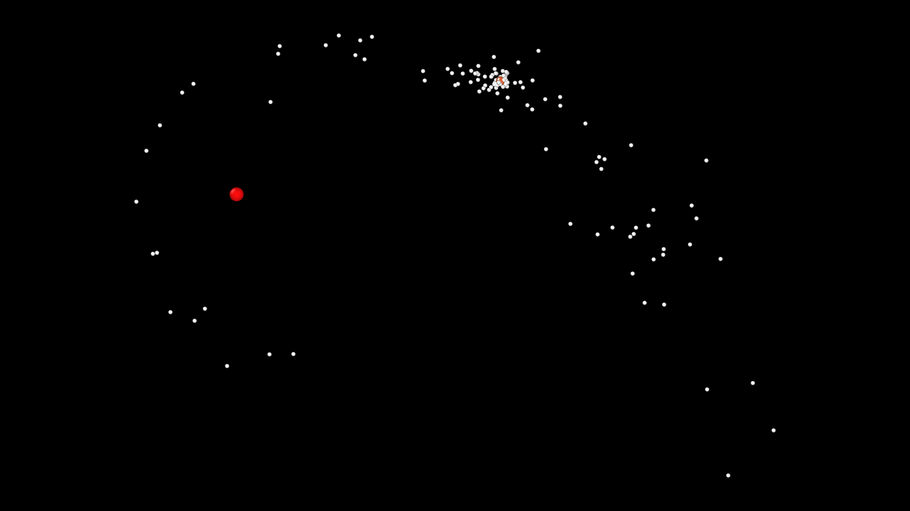
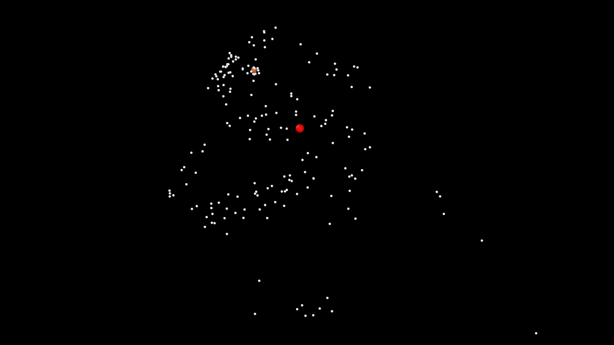

# GTS_ML

**Galactic Tidal Stripping Simulations with Machine Learning**

A Python project for simulating the dynamical evolution of stellar clusters in a galactic tidal field and predicting their final state using machine learning.

## Overview

GTS_ML studies the effects of galactic tidal stripping on stellar clusters through numerical N-body simulations. The simulations follow the gravitational interactions between stars while accounting for the external gravitational potential of the host galaxy.

The results are used to investigate how the initial orbital parameters affect cluster survival and to train machine learning models capable of predicting whether a cluster survives or dissolves, without having to run a new N-body simulation for every configuration.

## Physical model

Both the stellar cluster and the host galaxy are described using a Plummer model.

The cluster is represented as a self-gravitating system of point-mass particles. Each star interacts gravitationally with the other cluster members, while the entire system evolves in the external galactic potential.

The initial orbit is defined by two parameters:

- **Semi-major axis** (`orbit_semi_major_axis`)
- **Eccentricity** (`orbit_eccentricity`)

The equations of motion are numerically integrated using [REBOUND](https://rebound.readthedocs.io/), with the Leapfrog integrator.

## Example simulations

The following images show two possible outcomes for the same initial cluster configuration under different orbital conditions.

| Surviving cluster | Dissolved cluster |
|:---:|:---:|
|  |  |
| a = 300.0, e = 0.5 | a = 140.0, e = 0.8 |
| Bound mass fraction: 0.93 | Bound mass fraction: 0.065 |
| Relative half-mass radius: 1.002 | Relative half-mass radius: 0.246 |

## Requirements

The simulation environment uses Python and the packages listed in `requirements.txt`.

Install the dependencies with:

```bash
pip install -r requirements.txt
```

Main dependencies:

- [REBOUND](https://rebound.readthedocs.io/) — N-body simulations
- [NumPy](https://numpy.org/) — numerical operations
- [SciPy](https://scipy.org/) — scientific computing
- [Numba](https://numba.pydata.org/) — just-in-time compilation

## Configuration

Simulation parameters are defined in `configuration.json`.

The configuration file controls:

- Simulation settings, including the integration timestep and integrator.
- Cluster generation, including the number of stars, cluster radius and random seed.
- Galactic potential, including galaxy mass and scale radius.
- Orbital parameters, including semi-major axis and eccentricity.
- Simulation duration and snapshot frequency.
- Number of CPU cores and output directory.

Multiple orbital configurations and initial cluster realizations can be specified in the configuration file.

## Running the simulations

### Linux

```bash
./run.sh
```

### NixOS

```bash
./nixrun.sh
```

Both scripts use `configuration.json` by default.

Additional command-line options are available:

```text
--config <path>
--verbose
--debug
```

For example:

```bash
./nixrun.sh --debug --config configuration.json
```

## Simulation diagnostics

During the simulations, diagnostic quantities are computed to follow the structural evolution of each cluster.

The main quantities include:

- **Bound mass fraction** — the fraction of the initial cluster mass that remains gravitationally bound.
- **Half-mass radius** — the radius enclosing half of the bound mass.
- **Virial ratio** — used to monitor the initial dynamical equilibrium.
- **Energy variation** — used to monitor the numerical integration.

These quantities provide a description of mass loss and structural evolution throughout the simulations.

## Dataset and machine learning

Simulation results are collected and organized into a dataset for subsequent analysis.

The dataset used in the thesis comprises **17,100 simulations**, obtained from 1,140 orbital configurations, each evaluated using 15 different initial cluster realizations.

The classification task uses two orbital parameters as input features:

- Semi-major axis.
- Orbital eccentricity.

Each simulation is classified according to its final bound mass fraction and relative half-mass radius:

- **Surviving:** bound mass fraction greater than 0.1 and relative half-mass radius greater than 0.2.
- **Dissolved:** either quantity is less than or equal to its respective threshold.

Two classifiers are implemented and compared:

- **Support Vector Classifier (SVC):** uses a second-degree polynomial kernel.
- **Multi-Layer Perceptron (MLP):** a neural network with two hidden layers containing 16 and 8 neurons.

The models are evaluated using a stratified 80/20 training-test split and the weighted F1-score.

Results obtained in the thesis:

| Classifier | Weighted F1-score |
|:---|---:|
| SVC | 0.9644 |
| MLP | 0.9642 |

## Documentation and analysis

The `Docs/` directory contains the thesis, figures and analysis materials.

- `Docs/asaro_valerio_laurea_26.pdf` — thesis document.
- `Docs/jupyter-notebooks/` — Jupyter notebooks used for data analysis, model training and figure generation.
- `Docs/plots/` — generated figures and associated data.
- `Docs/plots/commands/` — Python scripts used to generate selected figures.
- `Docs/images/` — images used in the thesis and documentation.

The notebooks are designed to run in [Google Colab](https://colab.research.google.com/).

## Project structure

```text
GTS_ML/
├── py/                  # Simulation source code
├── Docs/
│   ├── images/          # Images
│   ├── jupyter-notebooks/ # Analysis and ML notebooks
│   ├── plots/           # Generated figures and data
│   │   └── commands/    # Figure generation scripts
│   └── asaro_valerio_laurea_26.pdf
├── configuration.json   # Simulation configuration
├── requirements.txt     # Python dependencies
├── run.sh               # Linux execution script
└── nixrun.sh             # NixOS execution script
```

## Author

**Valerio Asaro** — [@Qw3rty26](https://github.com/Qw3rty26)
